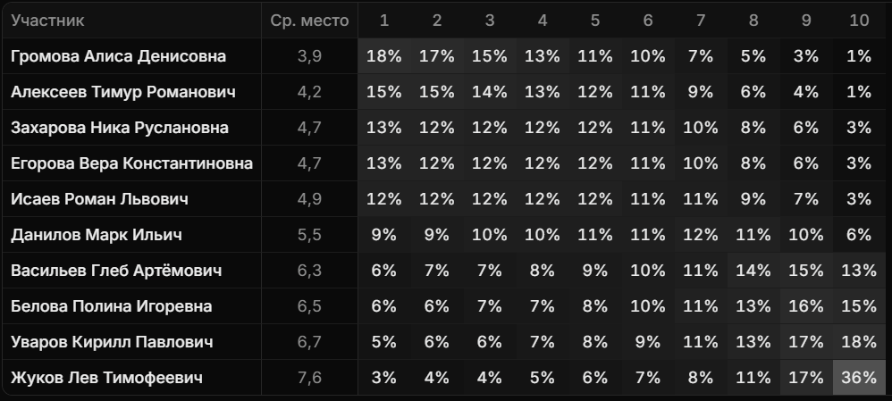

<div align="center">

# zQueue

Очередь на сдачу работ: случайный порядок с учётом прошлых занятий.

[**Открыть сайт**](https://zqueue.zubko.workers.dev) · [Как это работает](#как-это-работает) · [Запуск локально](#запуск-локально)



*Вероятности мест из [демо-комнаты](https://zqueue.zubko.workers.dev/r/N76JC3)*

</div>

<table>
  <tr><td><b>Честный порядок</b></td><td>Жеребьёвка на сервере, результат фиксируется сразу</td></tr>
  <tr><td><b>Учёт ожидания</b></td><td>Кто сдавал позже, получает больше шансов в следующий раз</td></tr>
  <tr><td><b>Приоритет по срокам</b></td><td>Три уровня срочности для тех, у кого истекают сроки</td></tr>
  <tr><td><b>Прозрачность</b></td><td>Журнал, записи которого нельзя изменить или удалить</td></tr>
  <tr><td><b>Без регистрации</b></td><td>Просмотр по коду комнаты, редактирование по ссылке-ключу</td></tr>
</table>

## Как это работает

Редактор отмечает, кто сдаёт работы. Сервер проводит жеребьёвку, а после занятия редактор отмечает, кто не успел сдать, и приоритеты обновляются.

<details>
<summary><b>Формула</b></summary>

```text
w = e^(β·p)      вес участника
P = w / Σw       вероятность первого места
```

`p` — накопленный приоритет, `β` — сила компенсации (по умолчанию 2,5). Следующие места разыгрываются так же среди оставшихся. В настройках комнаты можно выбрать другой способ жеребьёвки.

</details>

<details>
<summary><b>Начисление приоритета</b></summary>

| Результат | Начисление |
|---|---|
| Место в очереди | от 0 (первое) до 1 (последнее) |
| Не успел сдать | 1 (настраивается) |
| Не участвовал | 0,5 (настраивается) |

</details>

## Запуск локально

Нужен [Node.js](https://nodejs.org) версии LTS.

```bash
git clone https://github.com/geptanbubko/zqueue.git
cd zqueue
npm install
npm run db:migrate:local
npm run dev
```

Сайт откроется на <http://localhost:8787>, данные останутся на вашем компьютере.

<details>
<summary><b>Свой сервер на Cloudflare</b></summary>

```bash
npx wrangler login
npx wrangler d1 create queue-db
```

Замените `database_id` в `wrangler.jsonc` на значение из вывода, затем выполните:

```bash
npm run db:migrate
npm run deploy
```

</details>

## Блэкджек

У каждой комнаты свой стол. Игроки входят по адресу
`/r/<КОД_КОМНАТЫ>/blackjack/join#key=<СЕКРЕТ_ССЫЛКИ>` и вводят персональный пароль.
За столом до пяти игроков. Первая ставка открывает приём ставок на 20 секунд.
При входе игрок занимает случайное свободное место, которое освобождается при выходе.
Кнопка **Upload avatar** задаёт аватар игрока во всех комнатах. Можно выбрать
PNG, JPEG или WebP размером до 10 МБ. Браузер обрежет изображение до квадрата.
Остальные могут поставить или пропустить раздачу. Дилер раздаёт карты из шести
колод, когда все ответили или время вышло. Игроки ходят слева направо по местам
за столом. На каждый ход даётся 20 секунд. После добора без перебора или 21
игрок получает ещё 20 секунд. Если время вышло, засчитывается пас. Во время игры
зрители открывают трансляцию кнопкой «Смотреть» в красной плашке комнаты.
Чат доступен и игрокам, и зрителям.

При первом входе игрок получает 10 000 фишек. Затем каждые 60 минут начисляется
ещё по 10 000, до трёх начислений подряд без расходов, включая первый бонус.
Списанная ставка сбрасывает счётчик начислений. Если начисления уже остановились,
следующие 10 000 придут через час после расхода. Баланс общий для всех комнат.

Перед раздачей каждый выбирает ставку кнопками или ползунком с шагом 100 фишек.
All-in выбирает максимальную доступную ставку, кратную 100. Ставки списываются
при раздаче, а выплаты зачисляются по её итогам. Обычная победа приносит
выигрыш в размере ставки, блэкджек с двух первых карт — 3:2, при ничьей
ставка возвращается. Под именем игрока видны выигранные и проигранные фишки
за последние 24 часа по всем комнатам.
Внизу страницы видны общий баланс каждого игрока и изменение за 24 часа
с учётом начислений, ставок и выплат. После установки обновления история
баланса отсчитывается от момента применения миграции.

- Дабл удваивает ставку на руку с двумя картами. Игрок получает одну карту,
  после чего ход этой руки завершается.
- Сплит разделяет пару одного ранга на две руки с одинаковыми ставками.
  Можно разыграть до четырёх рук. После сплита тузов на каждую руку даётся
  одна карта. При победе с 21 после сплита выигрыш составляет 1:1.
- При открытом тузе дилера игроки получают 20 секунд на решение о страховке.
  Она стоит половину основной ставки и оплачивается 2:1 при блэкджеке дилера.
  По истечении времени игроки, которые не ответили, продолжают без страховки.

### Настройка

После применения миграций задайте два секрета Worker. Сгенерировать секрет ссылки
и отдельный пароль для каждого игрока можно командой `openssl rand -hex 24`.

Для локального запуска добавьте в `.dev.vars` рядом с `wrangler.jsonc`:

```dotenv
BLACKJACK_ENTRY_KEY="секрет_ссылки"
BLACKJACK_PASSWORDS='{"ZerG":"пароль_1","Binar":"пароль_2","xekrii":"пароль_3","Acute":"пароль_4","jiumohhbiu":"пароль_5"}'
```

Замените примеры своими значениями. Все пять паролей должны различаться. Для
Cloudflare задайте эти же переменные как секреты через панель Worker или команды
`npx wrangler secret put BLACKJACK_ENTRY_KEY` и `npx wrangler secret put BLACKJACK_PASSWORDS`.
В качестве значения второго секрета введите JSON без внешних кавычек.

## Технологии

| Сервер | База | Интерфейс |
|---|---|---|
| Cloudflare Workers, TypeScript | Cloudflare D1 (SQLite) | HTML, CSS, JavaScript |

## Лицензия

[MIT](LICENSE)
